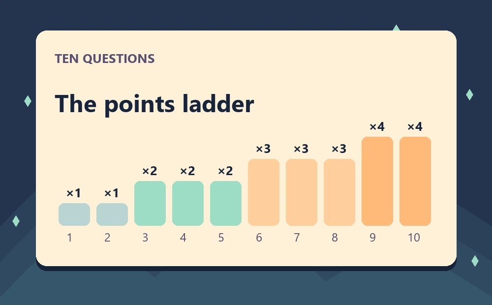

# Kabloom Sky Climb

[Play the free daily climb and read the guide](https://kabloom.cc/)

Kabloom.cc is an independent guide to one-use trivia. Play the ten-question Sky Climb stage of Crowdict Draft, then use the illustrated guide to understand spent answers and question weights.

## Play, plan, and review your picks

- [Play Sky Climb](https://kabloom.cc/#play) and see how far you can climb when each accepted answer can be used only once.
- [Read the illustrated guide](https://kabloom.cc/#guide) to recognise the timer, the spent-answer list, and the final score breakdown.
- [Compare picks in the score calculator](https://kabloom.cc/#calculator) to see how swapping two sample answers affects your total.

